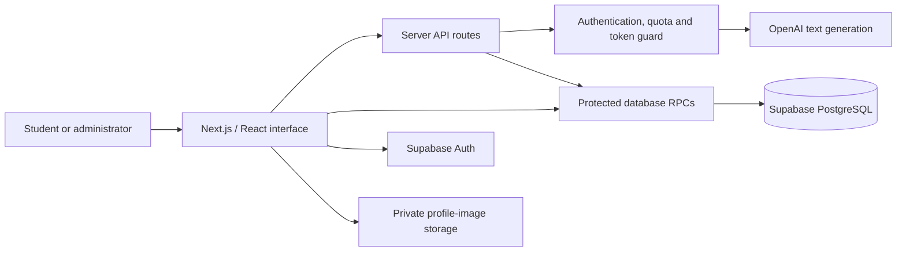

<p align="center">
  <a href="https://eltun.dev">
    
  </a>
</p>

<h1 align="center">Kairo</h1>
<p align="center"><strong>Follow the questions. Understand the answers.</strong></p>
<p align="center">A personalized learning platform built around real practice, guided explanations and steady progress.</p>

<p align="center">
  <a href="https://eltun.dev">Live website</a> &nbsp;·&nbsp;
  <a href="#learning-experience">Features</a> &nbsp;·&nbsp;
  <a href="#local-development">Development</a> &nbsp;·&nbsp;
  <a href="#architecture">Architecture</a> &nbsp;·&nbsp;
  <a href="#project-documentation">Documentation</a>
</p>

<p align="center">
  
  
  
  
</p>

## What is Kairo?

Kairo helps students discover what they understand, find the topics that need attention and decide what to study next. It connects assessments, an AI teacher, personal plans, interactive experiments and educational competitions in one account.

The core learning catalogue covers **Mathematics, Physics, Biology, Geography and Chemistry**. Available grades and topics come from the project's curriculum catalogue; they are validated for each subject. The primary interface is Azerbaijani.

The White Rabbit is the platform's visual guide: an optional entrance, restrained parallax, a pocket-watch shortcut to Focus Mode and accessible navigation. The current character is the high-resolution portrait embedded above, with a vector fallback. Small feature cards use original SVG visualizations instead of heavy video or WebGL scenes.

## Learning experience

| Feature | What students can do |
| --- | --- |
| **Practice and examinations** | Build a class-based or mixed-grade trial, choose multiple subjects and a question count, resume saved answers and review dated results. |
| **AI teacher** | Start a subject/grade-specific lesson, ask follow-up questions, receive staged hints and explicitly reveal a full solution. Lessons persist in the account. |
| **Adaptive study plans** | Follow a daily timeline, open plans across subjects and grades, track tasks and move directly into a lesson, mini-test or focus session. |
| **Progress dashboard** | Inspect recorded attempts, correct/incorrect answers, daily activity and weak topics. Missing evidence stays unknown. |
| **Replay and mistake analysis** | Revisit completed exams, inspect recorded answer changes and timing, and classify mistakes. |
| **University goals** | Search and filter program variants, compare up to three, save personal targets and choose a primary goal. Only compatible verified scores contribute to admission-scale progress. |
| **Focus Mode** | Use configurable work/break sessions with pause/resume controls and server-confirmed study time. |
| **Duels and Arena** | Challenge real participants, join scheduled trials or knockout events, and view stored outcomes, ratings and achievements. |

### Interactive laboratories

**17 browser-local activities across five subject groups**, with no AI token usage:

- **Mathematics:** function graphs, geometry, probability and the unit circle.
- **Physics:** circuits, motion, optics and pendulums.
- **Chemistry:** molecules, reactions, the first 20 elements and pH.
- **Geography:** geographic coordinates, synthetic climate graphs and tectonic plates.
- **Informatics:** sorting/searching algorithms and logic-gate networks.

These are simplified teaching models with stated assumptions. Biology remains an assessment subject; its laboratories are no longer part of the lab catalogue.

### Administration

Authorized administrators can inspect student learning evidence and competition results, manage supported account fields, review content, operate tournaments and inspect sanitized activity/audit records. Arena creation includes Baku-time calendar inputs, quick schedules and chronological validation on both client and server.

Private profiles, public competition nicknames and administrator permissions are separate concerns. A student ID is an identifier, not a login credential or an authorization grant. Teacher-owned classrooms are a future extension.

## Architecture



| Layer | Implementation |
| --- | --- |
| Frontend | TypeScript, React 19, Next.js 16 App Router, CSS and Tailwind CSS 4 |
| Motion and visualization | Framer Motion, original SVGs, Recharts and KaTeX |
| Server | TypeScript API routes running on Node.js |
| Data and authorization | PostgreSQL, SQL/PLpgSQL functions, ownership checks and RLS |
| Managed services | Supabase Auth/Storage, OpenAI API and Vercel |

Browser drafts support recovery, but they are not authoritative competitive results. Exam/duel scoring, deadlines and competition transitions use server-held records. Account changes clear or rebind private UI state.

## Local development

### 1. Install

Use **Node.js 24** and npm. The lockfile is committed.

```bash
git clone https://github.com/EltunLTN/kairo.git
cd kairo
npm ci
```

### 2. Configure the environment

Copy `.env.example` to `.env.local` and supply development credentials. Do not commit real values.

| Variable | Visibility | Purpose |
| --- | --- | --- |
| `NEXT_PUBLIC_SUPABASE_URL` | Browser | Supabase project URL |
| `NEXT_PUBLIC_SUPABASE_PUBLISHABLE_KEY` | Browser | Limited public project key |
| `OPENAI_API_KEY` | Server only | OpenAI project credential |
| `OPENAI_MODEL` | Server only | Configured snapshot: `gpt-5.4-mini-2026-03-17` |
| `ACTIVITY_SERVER_SECRET` | Server only | Server attestation; must match the database configuration |
| `CRON_SECRET` | Server only | Authentication for scheduled maintenance |
| `ENABLE_RESOURCE_SEARCH` | Server only | Kept `false`; paid discovery is disabled |

Changing `OPENAI_MODEL` alone does not bypass the model allowlist in `lib/ai/budget.ts`. The AI wrapper, database budget policy and deployment configuration must agree. Never expose an API key, service-role credential or server secret through a `NEXT_PUBLIC_` variable.

### 3. Prepare the database and authentication

The application requires the matching Supabase schema and Auth configuration. For an **existing environment**, apply only missing versions from `supabase/migrations/` in chronological order.

For a **fresh environment**, establish the legacy account/profile, analytics and activity prerequisites in `database/` before applying the expansion migrations. This repository contains an incremental rollout history, not a single empty-database bootstrap command. Follow the [platform rollout notes](docs/platform-expansion-release.md#configuration-and-local-execution) and the [learning workspace rollout](docs/learning-workspace-release.md); do not reapply historical SQL blindly.

Configure Auth site/redirect URLs for the intended origin, enable email confirmation and configure SMTP for public registration. The project owner must provision the private administrator allowlist through a trusted database administration path. Editing a browser profile cannot grant administrator access.

### 4. Start

```bash
npm run dev
```

Open [localhost:3000](http://localhost:3000). Use a confirmed development account for personal learning flows. Missing AI credentials, attestation or quota availability produce explicit errors; fabricated answers are not substituted.

### 5. Check changes

```bash
npm test
npm run lint
npx next typegen
npx tsc --noEmit
npm run build
```

The current automated suite contains 75 tests covering generation validation, access control, budgets, result integrity, laboratory formulas and tournament scheduling. Database checks live under `database/verify-*.sql`; inspect their prerequisites and run rollback-based fixtures in a suitable development environment. Live verification scripts are opt-in and require separate disposable QA credentials.

## Routes at a glance

| Route | Purpose |
| --- | --- |
| `/` | Home, White Rabbit and learning journey |
| `/onboarding` | Grade, subjects, topics and trial configuration |
| `/quiz` | Compatibility redirect to the current practice builder |
| `/kairo` | Eight interactive learning-tool cards |
| `/kairo/exam` | Published exams and session history |
| `/kairo/exam/session/[id]` | Saved examination, answers and review |
| `/kairo/tutor` | Persistent AI lessons |
| `/plan` | Subject/grade plan library and daily timeline |
| `/dashboard` and `/results` | Personal analytics and account-backed history |
| `/kairo/university-goals` | University discovery, comparison and goals |
| `/kairo/focus` and `/kairo/lab` | Focus sessions and local experiments |
| `/kairo/duel` and `/kairo/arena` | Competitive practice and scheduled events |
| `/kairo/mistakes` and `/kairo/replay/[id]` | Mistake analysis and recorded replay |
| `/account` | Authentication, profile and cloud controls |
| `/admin`, `/admin/overview`, `/admin/kairo` | Restricted administration |

## AI, scoring and content boundaries

- AI calls are authenticated, bounded and validated. Active protected exams/duels block AI assistance.
- The shared application guard reserves tokens before inference and stops at **2,000,000 reserved tokens per UTC day**. It does not refund uncertain/aborted requests or automatically switch to a paid model/tool.
- This counter is not an organization-wide billing cap and cannot verify continued complimentary-token eligibility or other applications' consumption. Read the [AI operations guide](docs/complimentary-ai.md) before changing provider settings.
- Practice accuracy is not an official DIM score or an admission probability. Assisted learning, task completion and competition points do not inflate independent mastery.
- Curriculum references guide subject/grade alignment; full textbook content is not mirrored. Supplementary links come from the reviewed resource catalogue; unavailable matches stay unavailable.
- Admission variants may be preliminary or carry unconfirmed reported cutoffs. Missing values are not zero; special-ability scales retain their original meaning.

## Deployment and repository identity

The canonical source repository is **[EltunLTN/kairo](https://github.com/EltunLTN/kairo)**. The production domain is **[eltun.dev](https://eltun.dev)**.

The existing Vercel project may retain its original `ai-work` project name. A Vercel project name, a GitHub repository name and a custom domain are independent identifiers; renaming this repository does not require recreating the application, database or domain.

Pushes to `main` deploy production; other connected branches create previews. Verify the intended Git connection, environment variables and READY build before release. Scheduled maintenance is declared in `vercel.json` and uses `CRON_SECRET`.

For an older local checkout:

```bash
git remote set-url origin https://github.com/EltunLTN/kairo.git
git remote -v
```

## Project map

```text
app/                  Routes, server endpoints and shared styles
components/           Learning modules, account/admin UI and visual components
lib/ai/               Provider access, validation and token-budget guard
lib/kairo/            Domain contracts, RPC hooks and learning models
lib/labs/             Deterministic browser-local experiments
data/                 Curriculum, educational references and admission catalogues
public/kairo/         White Rabbit portrait and visual assets
database/             Legacy schema steps and transactional verification scripts
supabase/migrations/  Versioned incremental database changes
tests/                Automated regression suite
docs/                 Architecture, rollout and operational notes
```

## Project documentation

- [Premium home, Tools cards and goals design](docs/premium-design-release.md)
- [Arena calendar validation](docs/arena-calendar-fix.md)
- [Reliable learning flows and laboratory models](docs/nov5-reliability-and-labs.md)
- [Platform modules, permissions and deployment](docs/platform-expansion-release.md)
- [Dashboard, mixed exams and activity journal](docs/learning-workspace-release.md)
- [Complimentary AI budget and operating limits](docs/complimentary-ai.md)
- [White Rabbit asset and fallback](docs/rabbit-v2.md)

Historical release notes describe their own release dates; use the current implementation and newer notes when behavior has changed.

## Maintainer and license

Maintained by **[Eltun Jalilli](https://github.com/EltunLTN)**. No `LICENSE` file is currently included in this repository.

<p align="center"><sub>Sualların arxasınca get.</sub></p>

